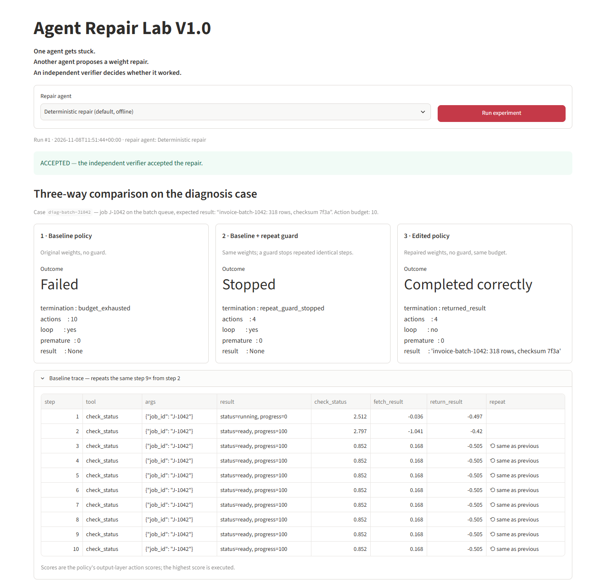
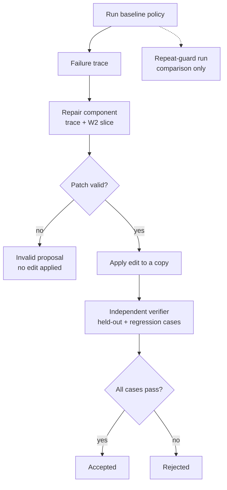

# Agent Repair Lab

**V1.0 · AI Research & Applied POCs**

**What.** A small task agent gets stuck calling the same tool over and over. A repair component reads the trace, then proposes a small numeric edit to the neural policy that drives the agent. An independent verifier then checks whether the edited agent can actually finish the task.

**Why.** Stopping a loop saves wasted work, but that alone is not a repair. A real fix has to produce the correct result, and it must not break behavior that already worked.

**How.** The same task runs three ways: with the original policy, with the original policy plus a repeat guard, and with the edited policy. The edit is then checked against held-out and regression cases. The verifier makes the decision, not the repair component.



## How it works



The repeat guard is only a comparison run; it does not produce the repair. An edit can pass validation and still be rejected by verification. Details are in the [experiment document](docs/EXPERIMENT.md#flow).

## Results from the default run

| Variant | What happened | Actions | Task completed? |
|---|---|---|---|
| Original policy | Kept repeating `check_status` until the 10-action budget ran out | 10 | No |
| Original policy + repeat guard | Guard stopped the loop | 4 | No: stopped, but no result |
| Edited policy | Fetched and returned the correct result | 4 | **Yes** |

The edit changed one weight, from 0.187 to 1.368. The verifier ran 5 cases (the original failure, a held-out failure, two regression cases and a delayed-ready case) and **accepted** the edit. A deliberately bad edit (`rebalance`) fixes the original failure but breaks two cases that used to work, and the verifier **rejects** it.

## Run locally

```bash
docker compose up --build
```

Open **http://localhost:8501**, press **Run experiment**, and see the **Help Center** tab for a guided tour. If port 8501 is taken, choose another host port:

```bash
AGENT_REPAIR_LAB_PORT=8502 docker compose up --build
```

Reproduce the experiment without the UI (Python 3.11+, after `pip install -e .`):

```bash
python -m agent_repair_lab
```

The [usage guide](docs/USAGE.md) covers local setup without Docker, the negative controls, JSON output, Ollama and troubleshooting.

## Repair modes

The default repair is **deterministic**: a transparent, rule-based component that computes the edit from the failing trace. No LLM is involved, and the demo runs fully offline.

An optional path sends the same inputs to a **local LLM through Ollama**. Its proposal goes through the same validation and verification. The adapter is tested offline with simulated responses, but **a run against a live model has not been verified yet**.

## Documentation

- [Documentation index](docs/README.md)
- [Experiment](docs/EXPERIMENT.md): the scenario, the neural policy, the weight edit, verification rules, measured results, limits and the [flow diagram](docs/EXPERIMENT.md#flow)
- [Usage guide](docs/USAGE.md): running the app, reading results, CLI, Ollama, troubleshooting

## Sources and Inspiration

- **Primary research.** Rikiya Takehi, Jayden Teoh, Alex Zhang, and Omar Khattab, [*Sparks of Weight-Space Programming: LLMs can natively read & write neural network weights*](https://rikiyat.github.io/blog/weight-space-programming/), November 2026. This is preliminary research from MIT CSAIL.
- **Video inspiration.** Code Cave, [*ניתוח מוח פתוח: מה קורה כש-AI מתקן את המוח של AI אחר?*](https://www.youtube.com/watch?v=VAbXapGNveU)

Agent Repair Lab is a separate small-policy experiment inspired by that research. It does not reproduce the researchers' results. Any published figures are theirs, and are cited separately in the [experiment document](docs/EXPERIMENT.md#8-sources-and-inspiration). What this project adds is independent verification of proposed repairs, using held-out and regression checks.

---

Built and developed by Oren Salami · V1.0
