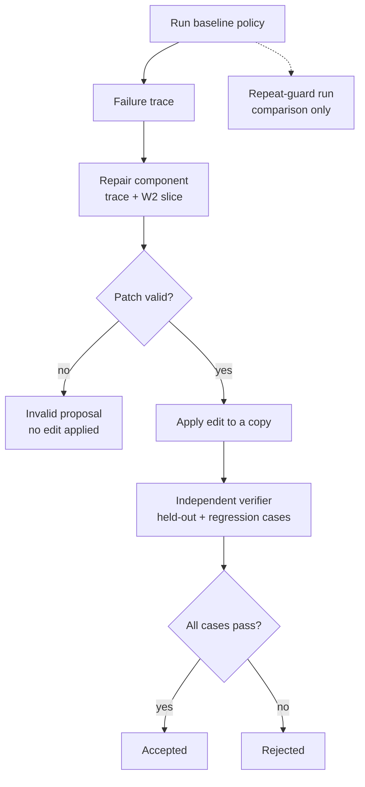
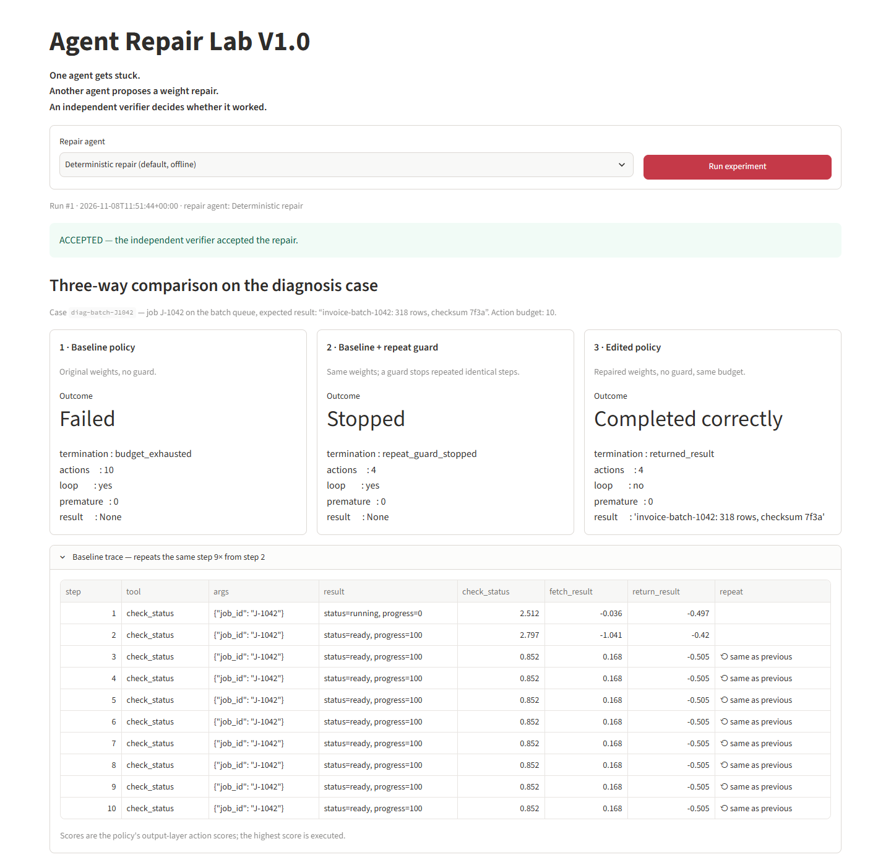
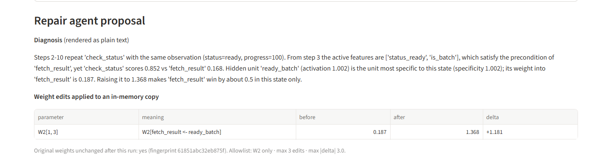
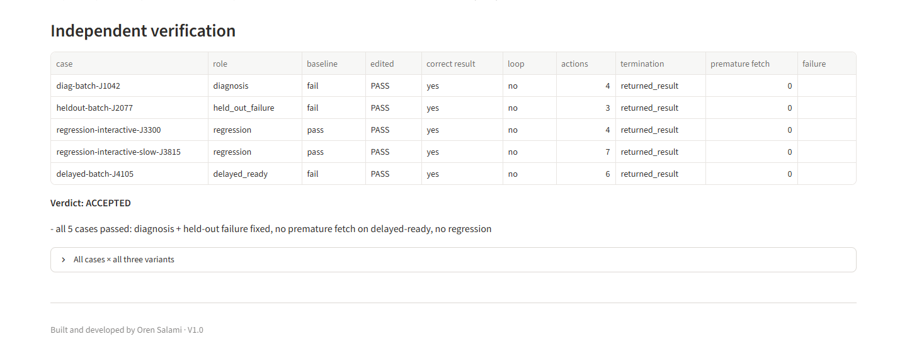

# Agent Repair Lab V1.0 — Experiment

**Question:** Can one AI agent diagnose why another agent is stuck, propose a targeted numeric change to the neural policy driving it, and produce a repair that passes independent verification?

This document describes what was built and what was observed in an actual local run on 2026-11-08 (Python 3.12, NumPy, Streamlit 1.60, Docker Desktop 29.9). All numbers below come from that run and are reproducible with `python -m agent_repair_lab`. For setup and day-to-day use, see the [usage guide](USAGE.md).

## Flow

The repeat-guard run uses the original policy and serves only as a comparison. It does not feed the repair component. A proposal can pass patch validation and still be **rejected** by behavioural verification, which is what happens to the `rebalance` negative control (section 6). A repair component that fails to produce a proposal, such as an unreachable LLM, ends the run before validation, with status `repair_failed`.

## 1. Task and environment

A simulated job service (`environment.py`) holds one job. Every tool call advances a clock by one tick. The job reports `running` (with a rising `progress` value) until tick `ready_at_tick`, and `ready` after that.

| Tool / action | Effect |
|---|---|
| `check_status(job_id)` | returns `status=running, progress=N` or `status=ready, progress=100` |
| `fetch_result(job_id)` | returns the result if the job is ready; otherwise `not_ready`, which is recorded as a **premature fetch** |
| `return_result` | ends the run and returns whatever result the agent holds (possibly `None`) |

Each run has a deterministic budget of **10 actions**. Each trace step records the step number, tool, arguments, result summary, input features, hidden activations and action scores.

### Policy

`policy.py` holds a real NumPy MLP: `hidden = relu(W1 · x + b1)` and `scores = W2 · hidden + b2`. The executed action is `argmax(scores)`. The weights are fixed local parameters (`fixtures/baseline_policy.json`). They are hand-designed rather than trained, with small fixed perturbations (seed 1042, ±0.03, rounded to 3 decimals) so that no value is artificially round.

| Input features (6) | Hidden units (7) | Actions (3) |
|---|---|---|
| `no_status_yet` | `start` | `check_status` |
| `status_running` | `waiting` | `fetch_result` |
| `status_ready` | `ready_interactive` | `return_result` |
| `is_batch` | `ready_batch` | |
| `has_result` | `holding_result` | |
| `last_fetch_not_ready` | `status_seen` | |
| | `bias` (constant) | |

**Editable layer:** only the output layer `W2` (3 × 7), as enforced by the patch allowlist.

### The injected fault

`W2[fetch_result ← ready_batch]` is **0.187**. In the state *ready + batch + no result*, the policy scores `check_status` at **0.852** and `fetch_result` at **0.168**. The agent therefore keeps calling `check_status` after the job reports ready. Interactive jobs are unaffected, because the `ready_interactive` unit feeds `fetch_result` with weight 1.988.

The baseline, guarded and edited agents all run the same `TaskAgent.run` with the same environment and tools. The code has no special-case branch for patched policies or for particular scenario IDs. The policy parameters are the only experimental variable, plus the guard in variant 2.

## 2. Scenarios

The repair agent sees only the **diagnosis case**. The verification fixtures are passed straight from the experiment runner to the verifier. They are held out from the repair agent, though they are in the repository so the experiment can be reproduced. Every `expected_result` is written by the fixture author, independently of any agent output.

| Case | Role | Queue | Ready at tick | Baseline |
|---|---|---|---|---|
| `diag-batch-J1042` | diagnosis (seen by repair agent) | batch | 1 | fails (loop) |
| `heldout-batch-J2077` | held-out failure: same mechanism, different inputs | batch | 0 | fails (loop) |
| `regression-interactive-J3300` | regression | interactive | 1 | passes |
| `regression-interactive-slow-J3815` | regression (legitimate waiting, 5 polls) | interactive | 4 | passes |
| `delayed-batch-J4105` | delayed-ready: detects premature fetch | batch | 3 | fails (loop) |

## 3. Three-way comparison (observed)

On the diagnosis case:

| Variant | Termination | Actions | Loop | Result |
|---|---|---|---|---|
| 1. Baseline | `budget_exhausted` | 10 | yes (9 identical steps from step 2) | `None` |
| 2. Baseline + repeat guard | `repeat_guard_stopped` | 4 | yes | `None` (task **not** completed) |
| 3. Edited policy | `returned_result` | 4 | no | `invoice-batch-1042: 318 rows, checksum 7f3a` ✔ |

The **repeat guard** stops a run once 3 consecutive steps have an identical signature (tool, arguments, observation, result held). Progress changes during legitimate polling, so a running job never triggers it. The `regression-interactive-slow-J3815` case polls 5 times and completes under the guard. Stopping the loop does not count as success. The guard turns *stuck* into *stopped*, but only the weight edit turns it into *completed*.

All cases × all variants (observed):

| Case | Baseline | Guarded | Edited |
|---|---|---|---|
| diag-batch-J1042 | fail (budget, 10) | fail (guard, 4) | **pass** (4) |
| heldout-batch-J2077 | fail (budget, 10) | fail (guard, 3) | **pass** (3) |
| regression-interactive-J3300 | pass (4) | pass (4) | **pass** (4) |
| regression-interactive-slow-J3815 | pass (7) | pass (7) | **pass** (7) |
| delayed-batch-J4105 | fail (budget, 10) | fail (guard, 6) | **pass** (6) |

## 4. Repair agents

Both repair agents receive the same `RepairRequest`, and nothing else:

- the failing trace of the diagnosis case;
- definitions of the features, actions (with their precondition features) and hidden units;
- the allowed slice: `W2` values with row and column labels;
- the patch constraints.

### Deterministic repair (default)

`DeterministicRepairAgent` computes its proposal from those inputs alone, in five steps:

1. Find the longest run of identical `(tool, observation)` steps. Here that is steps 2–10, `check_status → status=ready`.
2. Take the second step of the run as the **stuck state**: the agent has already seen `ready` and still repeats the call.
3. Choose the **target action**: the action whose precondition feature holds in the stuck state. `status_ready` satisfies the precondition of `fetch_result`.
4. Choose the **hidden unit** that is active in the stuck state and least active anywhere else in the trace. Here that is `ready_batch`, with activation 1.002 and specificity 1.002. `status_seen` and `bias` are also active elsewhere, so they are less specific.
5. Compute the new weight: `new = W2[target, unit] + (score_repeated − score_target + margin) / h_unit`, with margin 0.5. This gives 0.187 + (0.852 − 0.168 + 0.5) / 1.002 = **1.368**.

A test confirms the proposal is derived from the inputs, not hard-coded: when the trace scores are shifted by +0.4, the proposed value shifts by the same amount.

**Observed edit:**

| Parameter | Meaning | Before | After | Delta |
|---|---|---|---|---|
| `W2[1, 3]` | `fetch_result ← ready_batch` | 0.187 | 1.368 | +1.181 |

After the edit, in the stuck state, `fetch_result` scores 1.352 against 0.852 for `check_status`.

### AI agent repair: local LLM (optional)

`OllamaRepairAgent` posts the same `RepairRequest` (as JSON) to a local Ollama `/api/chat` endpoint, with temperature 0 and JSON output requested. The model has no access to verifier fixtures, files or code execution. Its reply is parsed as data and goes through **exactly** the same validation and verification as the deterministic proposal. If the service is unreachable, times out, returns an HTTP error, or returns output that is not valid JSON, the run is reported as `repair_failed`. Nothing is substituted.

**Live LLM status in this run: unverified.** No Ollama server was running on the development machine: the CLI was installed, but `localhost:11434` refused connections. The UI and CLI both reported `REPAIR AGENT FAILED — Ollama is unreachable`. The adapter is tested offline against simulated responses (valid, invalid, wrong original value, HTTP error, timeout, connection refused) and against an in-process HTTP stub.

## 5. Patch bounds and validation

A proposal is a JSON object with a `diagnosis` and a list of `edits`. Each edit has the form `{parameter, index, expected_original, new_value}`, with **absolute new values**, where delta = `new_value − expected_original`. The whole proposal is validated before any value is written:

- the parameter must be on the allowlist (**`W2` only**);
- the index must be a list of integers matching the parameter's rank and inside its shape;
- the proposal must not be empty, contain duplicate targets or malformed items, or exceed **3 edits**;
- values must be finite numbers;
- `expected_original` must match the baseline within **1e-3**, because the baseline is stored with 3 decimals;
- each |delta| must be at most **3.0**.

One bad edit invalidates the whole proposal. Valid edits are written to a **copy** of the policy. A fingerprint of the original weights is checked after every run: it is unchanged after accepted, rejected and invalid runs alike. Code produced by a repair agent is never executed.

## 6. Independent verification

`verifier.py` imports nothing from the repair agents. It runs the baseline and the candidate on the diagnosis case and on every verification fixture, and records, per case: whether the result is correct, whether a loop was detected (≥3 identical consecutive steps), the action count, the termination reason, the number of premature fetches, and pass/fail.

**Acceptance rule:** every case must complete with the expected result, with no loop and no premature fetch. This covers the diagnosis case, all held-out failure cases, all delayed-ready cases, and all regression cases the baseline already completes. Any failure is a rejection with a stated reason. A regression case is labelled `REGRESSION` when the baseline passed it and the candidate does not.

**Observed verdict for the deterministic repair: ACCEPTED.** All 5 cases passed.

### Negative controls (observed)

These are hand-crafted bad candidates, run through the same pipeline (`--source negative:<name>`):

| Candidate | Edit(s) | Does the loop stop on the diagnosis case? | Verdict and reason |
|---|---|---|---|
| `force-return` | `W2[return_result ← ready_batch]` −0.018 → 2.0 | yes, in 3 actions | **rejected**: wrong result (`None`) on the diagnosis, held-out and delayed cases |
| `force-fetch` | `W2[fetch_result ← bias]` −0.027 → 2.9 | yes, in 4 actions | **rejected**: premature fetch on 4 cases, including regressions on both interactive cases |
| `rebalance` | `ready_batch` 0.187 → 1.9 and `ready_interactive` 1.988 → 0.2 (both into `fetch_result`) | yes, and it passes the diagnosis and held-out cases | **rejected**: REGRESSION on both interactive cases (budget exhausted) |
| `excessive` | 4 edits, one with delta +9.813 | not run | **invalid proposal**: too many edits and delta above the limit; no weight written |

`rebalance` is the key negative result. It fixes the demonstrated failure and the held-out failure, and only the regression cases reveal that it is wrong.

## 7. Limits

- **Toy policy.** The policy is a hand-designed 6→7→3 MLP with one injected fault, not a trained or production network. The "slice" is the whole output layer, and its hidden units are interpretable by construction. That makes the diagnosis far easier than in a real model.
- **One scenario family.** There is one task (job polling) with 5 fixed cases. Passing them is evidence for this mechanism only, not a general guarantee.
- **Deterministic repair is not an LLM.** The accepted repair shown here was computed by a transparent rule-based agent. It demonstrates the repair-and-verify mechanics; it does not show that an AI model can find the repair. The LLM path is implemented and tested offline, but **no live LLM proposal was observed in this run**.
- **Held out by convention.** The verification fixtures are in the repository for reproducibility. They are held out from the repair agent's inputs, not secret.
- **Hand-written acceptance rules.** The verifier checks correctness, loops, premature fetches and regressions on the provided fixtures. A patch could still behave badly in states those fixtures do not cover.

## 8. Sources and Inspiration

1. **Primary research.** Rikiya Takehi, Jayden Teoh, Alex Zhang, and Omar Khattab, *"Sparks of Weight-Space Programming: LLMs can natively read & write neural network weights,"* November 2026.
   https://rikiyat.github.io/blog/weight-space-programming/
2. **Video inspiration.** Code Cave, *"ניתוח מוח פתוח: מה קורה כש-AI מתקן את המוח של AI אחר?"*
   https://www.youtube.com/watch?v=VAbXapGNveU

**About the research.** The MIT CSAIL authors report preliminary results: they describe them as very early, and say capabilities are still limited. In their work, frontier LLMs read and edit neural-network weights directly, guided by natural-language goals and without gradient descent. Their experiments include identifying what small networks were trained on, repairing a control policy, and writing small networks from scratch. In one experiment, the authors report that editing about 0.016% of Qwen3.5-0.8B's weights, with a 50-forward-pass budget, raised MATH-500 from 7.9% to 48.1% and GSM8K from 13.8% to 67.1%. **These figures are the researchers' own results.** Agent Repair Lab neither reproduces nor tests them.

**How this project differs.** Agent Repair Lab V1.0 is a separate small-policy experiment inspired by this research. Its own measured results are those in sections 3–6 above, kept separate from the research figures. Its contribution is the **independent verification of proposed repairs**:

- a bounded patch schema with allowlisting and validation before mutation;
- edits applied to an in-memory copy only;
- a three-way comparison that separates *stuck*, *stopped* and *completed*;
- a verifier that owns the verdict, using held-out failure cases, regression cases and a delayed-ready case;
- explicit rejection of patches that end the loop the wrong way.

---

Built and developed by Oren Salami · V1.0
