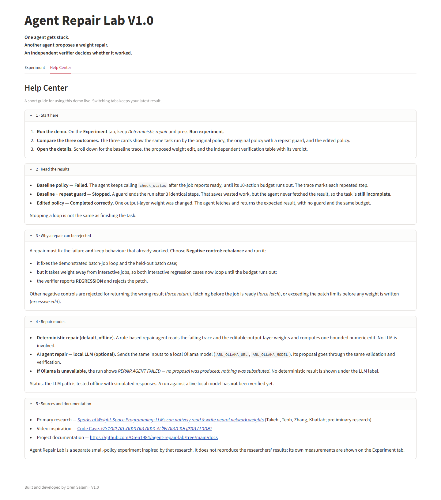
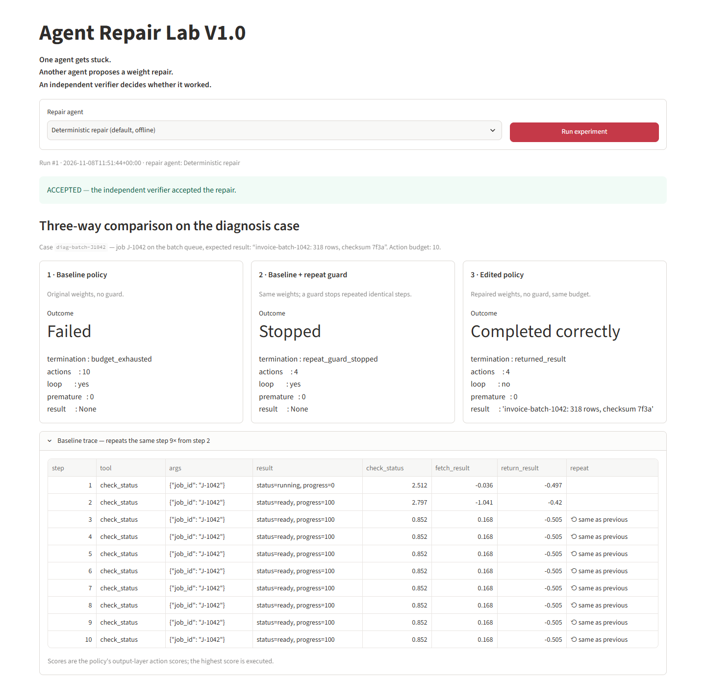
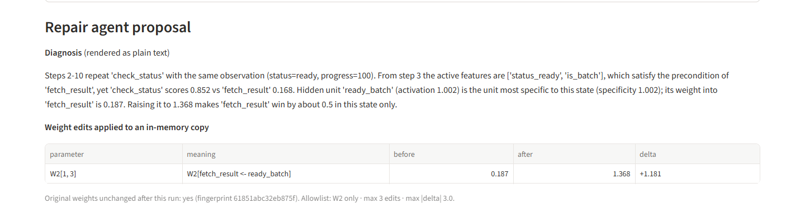
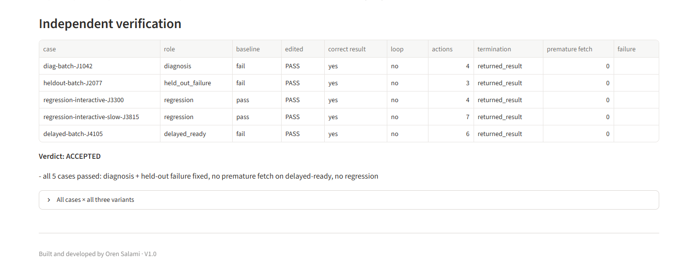

# Usage guide

How to start Agent Repair Lab, run the demo, read the results, and reproduce a run. For the experiment's design and evidence, see [EXPERIMENT.md](EXPERIMENT.md).

## Start the app

**With Docker** (recommended):

```bash
docker compose up --build
```

Open http://localhost:8501. If another app already uses port 8501, choose a different host port:

```bash
AGENT_REPAIR_LAB_PORT=8502 docker compose up --build
```

On Windows PowerShell, use `$env:AGENT_REPAIR_LAB_PORT=8502; docker compose up --build`. Stop the app with `docker compose down`.

**Without Docker** (Python 3.11+):

```bash
python -m venv .venv
.venv/Scripts/activate        # Linux/macOS: source .venv/bin/activate
pip install -e ".[dev]"
streamlit run app.py
```

## Run the default demo

1. On the **Experiment** tab, keep **Deterministic repair (default, offline)** selected.
2. Press **Run experiment**. A run takes about a second.
3. The green banner reports **ACCEPTED**: the independent verifier accepted the repair.

The **Help Center** tab holds a short version of this guide. Switching tabs does not start a run, and it keeps your latest result.



## Read the three results



| Card | What it shows |
|---|---|
| **1 · Baseline policy: Failed** | The original policy keeps calling `check_status` after the job reports ready, until its 10-action budget runs out. Each repeated step is marked in the baseline trace below the cards. |
| **2 · Baseline + repeat guard: Stopped** | A guard ends the run after 3 identical steps (4 actions in total). Work stops being wasted, but the result was never fetched, so the task is **incomplete**. |
| **3 · Edited policy: Completed correctly** | One weight changed. With no guard and the same budget, the agent fetches and returns the expected result in 4 actions. |

Further down the page:

- **Repair agent proposal** shows the diagnosis text and the exact edit: `W2[1, 3]` (`fetch_result ← ready_batch`) goes from 0.187 to 1.368.
- **Independent verification** shows each case, baseline vs. edited, and the verdict with its reasons.




## Try a repair that gets rejected

Choose **Negative control: rebalance (bad patch)** and press **Run experiment**. This patch fixes the demonstrated loop and the held-out batch case, but it takes weight away from interactive jobs. Both interactive regression cases then loop until the budget runs out, and the verdict is **REJECTED** with `REGRESSION` reasons.

The other negative controls fail for different reasons:

| Control | Why it is rejected |
|---|---|
| **force return** | Returns the wrong result (`None`) |
| **force fetch** | Fetches the result before the job is ready |
| **excessive edit** | Validation fails before any weight is written: too many edits, and a delta above the limit |

## Reproduce a run from the CLI

The CLI uses the same experiment runner and verifier as the UI.

```bash
python -m agent_repair_lab                                  # readable report (deterministic repair)
python -m agent_repair_lab --source negative:rebalance      # a rejected candidate
python -m agent_repair_lab --json --out report.json         # JSON report; add --full for traces
```

`--source` accepts `deterministic`, `llm`, `negative:force-return`, `negative:force-fetch`, `negative:rebalance` and `negative:excessive`.

Exit codes:

| Code | Meaning |
|---|---|
| `0` | Accepted |
| `1` | Rejected by the verifier |
| `2` | Invalid proposal, or the repair agent failed |

Run the offline tests with `pytest -q`.

## Optional: local LLM repair with Ollama

The default demo and the tests never contact an LLM. To try an LLM-generated proposal:

1. Start [Ollama](https://ollama.com) on the host and pull a model, for example `ollama pull llama3.1`.
2. Set any variables you need:

   | Variable | Default | Meaning |
   |---|---|---|
   | `ARL_OLLAMA_URL` | `http://localhost:11434` (local); `http://host.docker.internal:11434` (Compose) | Ollama endpoint |
   | `ARL_OLLAMA_MODEL` | `llama3.1` | Model name |
   | `ARL_OLLAMA_TIMEOUT` | `120` | Request timeout in seconds |

3. In the UI, choose **AI agent repair — local LLM via Ollama (optional)**. From the CLI, run `python -m agent_repair_lab --source llm`.

The LLM's proposal goes through the same validation and verification as the deterministic one. A live-model run has not been verified yet. So far the adapter has only been tested offline, with simulated responses.

## Troubleshooting

| Symptom | Fix |
|---|---|
| `port is already allocated` when starting Compose | Another app uses 8501. Set `AGENT_REPAIR_LAB_PORT` to a free port, or stop the other instance. |
| LLM mode shows **REPAIR AGENT FAILED — Ollama is unreachable** | Ollama is not running or not reachable. Start it, and check `ARL_OLLAMA_URL`. From the container on Docker Desktop, `host.docker.internal` points at the host. On Linux, start Ollama with `OLLAMA_HOST=0.0.0.0:11434` so the container can reach it. |
| LLM mode shows HTTP 404 | The model is not pulled. Run `ollama pull <model>`, or set `ARL_OLLAMA_MODEL` to a model you already have. |
| LLM mode shows **INVALID PROPOSAL** | The model replied, but its edit broke the patch rules (wrong `expected_original`, a parameter that is not allowed, or a delta that is too large). This is a real experimental result, not a crash. |
| The page shows an older result | Every run replaces the previous one and is numbered (**Run #n**) with a timestamp. Check the caption above the banner. |

[Back to the documentation index](README.md)
